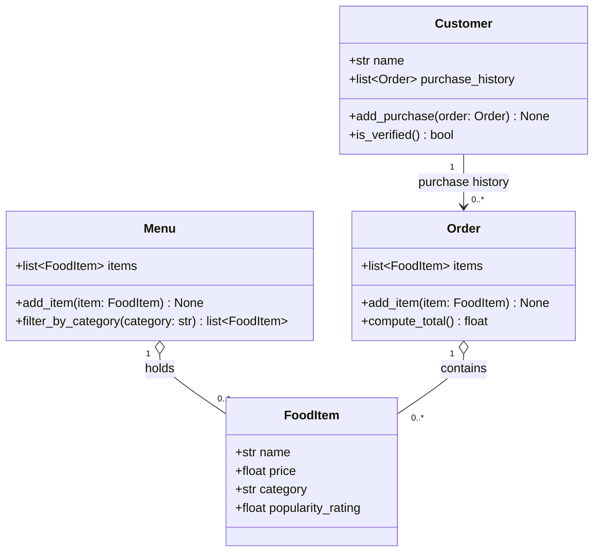

# ByteBites Class Diagram (Final)

## Design Notes

- **Four classes only**: `Customer`, `FoodItem`, `Menu`, `Order`. No Payment, Cart, or Category classes.
- **Attributes come straight from the spec**: customer name and purchase history; item name, price, category, and popularity rating; the menu's item list; the order's selected items.
- **`category` is a plain `str`**, so `filter_by_category()` compares strings (e.g. `"Drinks"`, `"Desserts"`).
- **The order total is computed when you ask for it**: `compute_total()` adds up the item prices each time it's called, and no `total` field is stored.
- **Verification rule**: `is_verified()` returns `True` when `purchase_history` has at least one order.
- **An order can start empty**: `Order` holds `0..*` items, which are added with `add_item()`. `compute_total()` returns `0.0` for an empty order.
- **Aggregation (`o--`)**: `Menu` and `Order` both refer to `FoodItem` objects without owning them. The same item can be on the menu and in many orders.
